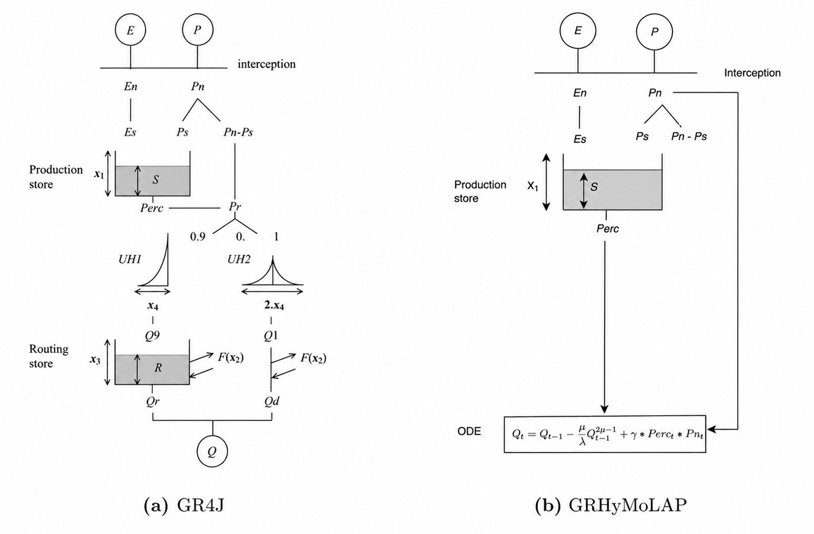

# GRHyMoLAP

<p align="center">
  
</p>

A lightweight rainfall–runoff modeling library providing the core GRHyMoLAP model equations and standard hydrological performance metrics.

GRHyMoLAP provides the mathematical computations required to simulate streamflow from precipitation and potential evapotranspiration. It is designed to give users full control over calibration, optimization, objective functions, parameter bounds, initial guesses, and warm-up procedures.

## Installation

From GitHub:

```bash
pip install git+https://github.com/Ezesia-lab/GRHyMoLAP_model.git
```

For local development:

```bash
pip install -e ".[dev]"
```

## Design

The package is organized into two main modules:

- **`grhymolap.model`** — core GRHyMoLAP model equations, including net flux computation, production-store percolation, and streamflow simulation. Sequential computations are JIT-compiled with [Numba](https://numba.pydata.org/).
- **`grhymolap.metrics`** — standard hydrological performance metrics: `nse`, `nnse`, `kge`, `lognse`, `rmse`, `mae`, and `pbias`.

The package does not implement automatic calibration or optimization. Users can integrate the model functions into their own calibration and evaluation workflows using their preferred optimization algorithms and objective functions.

## Import

Import the model functions and evaluation metrics directly:

```python
from grhymolap import net_fluxes, percolation, simulate_streamflow
from grhymolap import nse, nnse, kge, lognse, rmse, mae, pbias
```

## Model simulation

The main simulation function is:

```python
Qsim = simulate_streamflow(params, Q0, P, PET)
```

The four model parameters are ordered as:

```text
(MU, LAMBDA, X1, gamma)
```

where:

- `MU` and `LAMBDA` control streamflow recession dynamics.
- `X1` represents the production-store capacity parameter.
- `gamma` controls the contribution of the runoff generation term.

The inputs are:

- `params` — model parameter values.
- `Q0` — initial streamflow state.
- `P` — precipitation time series.
- `PET` — potential evapotranspiration time series.

Net precipitation (`Pn`) and net evapotranspiration (`En`) are automatically computed internally from `P` and `PET`.

The initial production-store state `S0` is optional and defaults to `X1 / 2`:

```python
Qsim = simulate_streamflow(params, Q0, P, PET)
```

The function returns the simulated streamflow time series.

## Individual model components

The individual model components are also available for users who want to access intermediate computations.

### Net fluxes

Compute net precipitation and net evapotranspiration:

```python
Pn, En = net_fluxes(P, PET)
```

### Percolation

Compute percolation from the production store:

```python
Perc = percolation(Pn, En, X1)
```

## User-defined calibration

GRHyMoLAP does not impose a particular calibration strategy. Users can define their own objective functions and use any compatible optimization algorithm.

For example, calibration can be performed using `scipy.optimize.minimize`.

### Defining an objective function

The following example uses NSE as the calibration objective:

```python
import numpy as np
from scipy.optimize import minimize

from grhymolap import simulate_streamflow, nse

n_warmup = 365

def objective(params, P, PET, Q_obs, n_warmup):

    Qsim = simulate_streamflow(params, Q_obs[0], P, PET)

    return 1 - nse(Q_obs[n_warmup:], Qsim[n_warmup:])
```

The warm-up period is defined and handled directly by the user. The first `n_warmup` timesteps are simulated but excluded from the objective function.

Set `n_warmup = 0` to disable the warm-up.

### Defining parameter bounds and initial guesses

```python
bounds = [
    (0.5, 4.0),       # MU
    (1e-6, 300.0),    # LAMBDA
    (1e-6, 5000.0),   # X1
    (0.0, 20.0)       # gamma
]

initial_guesses = [
    [0.7, 20.0, 500.0, 0.5],
    [1.0, 50.0, 1000.0, 1.0],
    [1.5, 100.0, 2000.0, 2.0],
]
```

### Running the optimization

```python
results = []

for guess in initial_guesses:

    res = minimize(
        objective,
        guess,
        args=(P_cal, PET_cal, Q_cal, n_warmup),
        method="Nelder-Mead",
        bounds=bounds,
        options={"maxiter": 2500, "disp": False}
    )

    results.append(res)

best_result = min(results, key=lambda res: res.fun)
best_params = best_result.x

print("Calibrated parameters:", best_params)
```

This example illustrates one possible calibration strategy. Users are free to choose other objective functions, optimization algorithms, parameter bounds, initial guesses, and optimization settings.

## Validation and continuous simulation

After calibration, the optimized parameters can be used for validation.

To preserve the evolution of the internal production-store state between calibration and validation periods, both periods can be simulated together:

```python
P_all = np.concatenate([P_cal, P_val])
PET_all = np.concatenate([PET_cal, PET_val])

Qsim_all = simulate_streamflow(best_params, Q_cal[0], P_all, PET_all)

Qsim_val = Qsim_all[len(Q_cal):]
```

## Performance evaluation

GRHyMoLAP provides standard hydrological metrics for evaluating simulated streamflow.

Available metrics:

- `nse` — Nash–Sutcliffe Efficiency.
- `nnse` — Normalized Nash–Sutcliffe Efficiency.
- `kge` — Kling–Gupta Efficiency.
- `lognse` — Logarithmic Nash–Sutcliffe Efficiency.
- `rmse` — Root Mean Square Error.
- `mae` — Mean Absolute Error.
- `pbias` — Percent Bias.

For example:

```python
from grhymolap import nse, kge, lognse, rmse, mae, pbias

scores_val = {
    "nse": nse(Q_val, Qsim_val),
    "kge": kge(Q_val, Qsim_val),
    "lognse": lognse(Q_val, Qsim_val),
    "rmse": rmse(Q_val, Qsim_val),
    "mae": mae(Q_val, Qsim_val),
    "pbias": pbias(Q_val, Qsim_val),
}

print("Validation scores:", scores_val)
```

All metrics use the signature `metric(obs, sim)` and exclude pairs containing NaN values.

## Examples

See `examples/A_CAMELS_FR_basin.py` for an example of single-basin model simulation and evaluation.

## License

MIT — see [LICENSE](LICENSE).

## Citation

If you use GRHyMoLAP in your research, please cite:

Houénafa, S. E., Latella, M., Gohouede, L. C., & Sezen, C. (2026). GRHyMoLAP: A process-driven ODE catchment hydrology model inspired by GR4J and HyMoLAP approaches. *Journal of Hydrology*, 135597.
